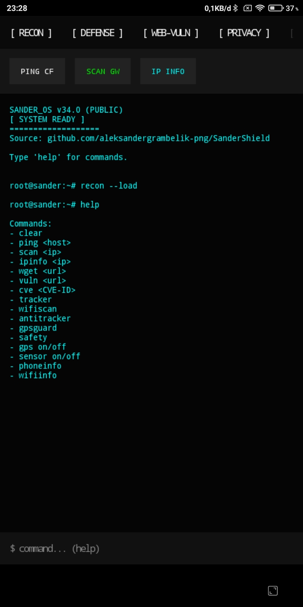
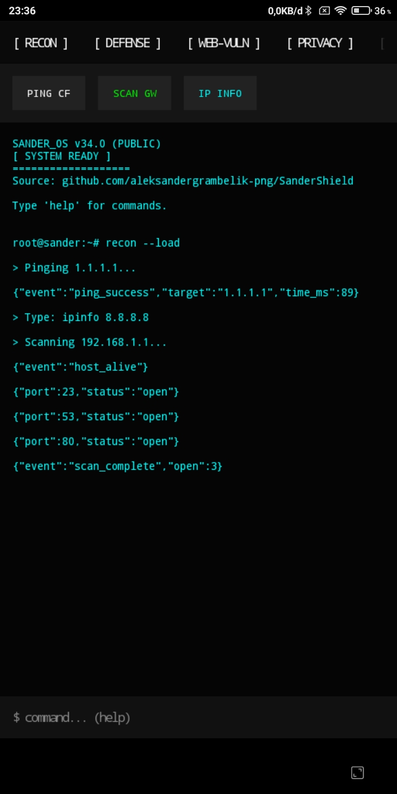
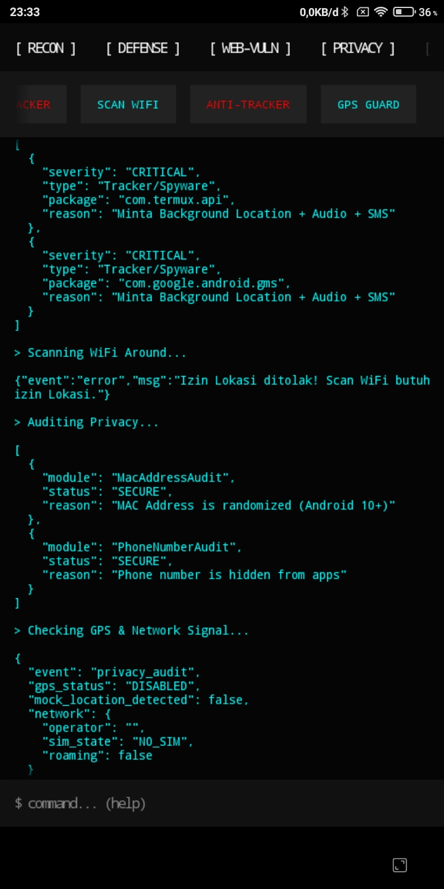
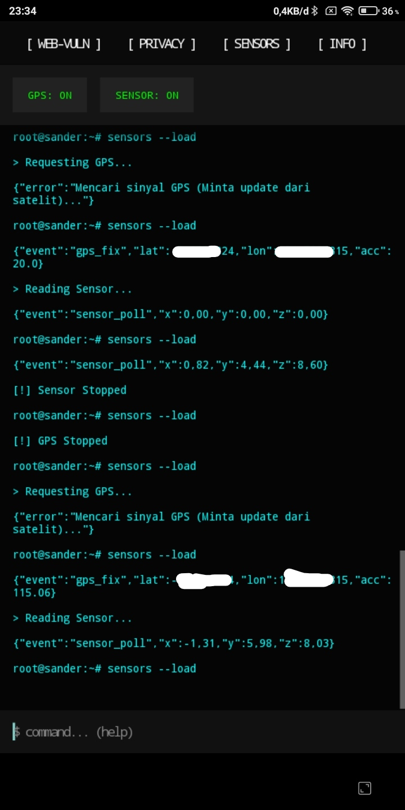

# SanderShield: Mobile Security Suite

SanderShield is a lightweight, zero-dependency Mobile Security Suite built entirely on Android using Termux. It is written in 100% Native Java without Gradle or Android Studio, designed for security researchers and bug bounty hunters who need a portable toolkit on the go.

> **Download APK:** [SanderShield.apk](https://github.com/aleksandergrambelik-png/SanderShield/raw/main/SanderShield.apk)

## Screenshots

| Main Terminal | Command Help |
| :---: | :---: |
|  |  |

| Vulnerability Scan (OWASP) | CVE Checker |
| :---: | :---: |
|  |  |

| Privacy & Anti-Tracker | GPS & Sensor Data |
| :---: | :---: |
|  |  |

## Features

- **Recon:** 100-Thread Port Scanner, Ping, IP Geolocation.
- **Web Vulnerability:** 12-Header Evidence Scanner (JSON Output), NVD CVE Checker.
- **Defense:** Anti-Phising Clipboard Bot, Stealth Tarpit Honeypot, Safety Guard (APK Signature Check).
- **Privacy:** Anti-Tracker Auditor, WiFi Scanner, GPS Guard.
- **Sensors:** GPS Tracker, Accelerometer, Camera.
- **Terminal:** Built-in manual command shell.

## Size & Performance

- **APK Size:** ~630 KB (Bypasses most Android AV).
- **Zero Dependencies:** No external libraries, 100% Java Standard Library.
- **No Root Required.**

## Installation

1. Download the latest `SanderShield.apk` from this repository.
2. Enable "Install from Unknown Sources" on your Android device.
3. Install the APK and grant necessary permissions (Location, Phone, Camera).
4. Open the app and start exploring the terminal.

**Note:** This app is protected by a digital signature. If the APK is repacked or modified, the Safety Guard will detect it and the app will not function properly.

## SHA256 Checksum

Verify your download integrity here:
`98F229735D9C0ECF40262C826400237678020CB8F4E7350833DDB61E43DE2AA1`

## License

This project is licensed under the **GNU Affero General Public License v3.0 (AGPLv3)**.
You are free to use, modify, and distribute this software, but you MUST keep it open-source and give credit to the original author. Closed-source commercial use is strictly prohibited.

See the [LICENSE](LICENSE) file for details.

## Disclaimer

This tool is for educational purposes and authorized security testing only. Do not use it on networks or devices you do not own. See [DISCLAIMER.md](DISCLAIMER.md) for details.

## Credits

- **Creator & Lead Developer:** [Aleksander Titan Pabiyuri (aleksandergrambelik-png)](https://github.com/aleksandergrambelik-png)
- **Co-Pilot & Assistant:** DeepSeek AI
